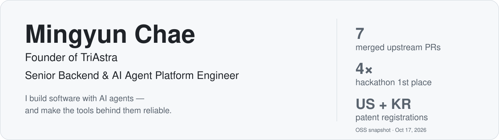

<picture>
  <source media="(max-width: 600px) and (prefers-color-scheme: dark)" srcset="assets/banner-dark-mobile.svg">
  <source media="(max-width: 600px)" srcset="assets/banner-light-mobile.svg">
  <source media="(prefers-color-scheme: dark)" srcset="assets/banner-dark.svg">
  
</picture>

  
  
  
  
   
  
  

  

### Building

**[TriAstra](https://triastra.ai)** — a multilingual product I build and operate as a solo engineer with an AI agent team: Rust services, web and mobile clients, and a ChatGPT integration.

| Registered users | Languages | Rust server-library tests | Merged PRs (7 days · 30 days) |
| :---: | :---: | :---: | :---: |
| **1,700+** | **7** | **3,635** | **776 · 1,051** |

Merged PRs: product repository, counted October 18, 2026, all authors including bots. User and Rust server-library test figures are October 15–17, 2026 snapshots.

[How the agent team works →](https://mg-mg-mg.github.io/agentic-engineering/)

### Reliability log

| Incident | Guardrail |
| --- | --- |
| A release-path change merged before its required verification evidence was recorded | Recorded the miss without backdating, completed the evidence afterwards, and made the merge tool refuse release-path changes without it |
| Independent review reproduced cleanup races that could delete a replaced file | Fixed before merge with atomic quarantine rename and identity/content verification |
| Production build sizing | Budgeted 32 GB; measured a sampled 14.7 GB peak RSS and zero swap during one build, not a universal capacity guarantee |
| A test fixture most likely inherited a Git hook's `GIT_*` environment and flipped `core.bare` in the shared repository | Fixed with isolated Git environments; the same bug class is proposed upstream in [Flutter #194429](https://github.com/flutter/flutter/pull/194429) (open) |

Private-operation accounts, not publicly reproducible incident records. [Methods, limits and current practice →](https://mg-mg-mg.github.io/agentic-engineering/)

### Open source

Fixes for problems I hit while running coding agents on real work.

**7 merged PRs** across [oh-my-pi](https://github.com/can1357/oh-my-pi) and [jcode](https://github.com/1jehuang/jcode), including shell execution, agent coordination and Korean IME input; **5 open proposals** across those projects, OpenTelemetry Rust, ts-rs and Flutter. Counted October 18, 2026.

| Project | Fix | Status |
| --- | --- | :---: |
| [oh-my-pi](https://github.com/can1357/oh-my-pi)  | Agent replies sent over messaging are acknowledged instead of reported as “no output.” |  |
| [jcode](https://github.com/1jehuang/jcode)  | Contiguous typing, including Korean IME input, undoes in one step. |  |
| [OpenTelemetry Rust](https://github.com/open-telemetry/opentelemetry-rust)  | A failed export is no longer hidden by a later successful batch during a flush. |  |
| [Flutter](https://github.com/flutter/flutter)  | Keep Flutter SDK Git queries from inheriting a Git hook’s repository environment. |  |

[All contributions →](CONTRIBUTIONS.md)

### Stack

<table>
  <tr>
    <td><b>Languages</b></td>
    <td> 
      </td>
  </tr>
  <tr>
    <td><b>Backend</b></td>
    <td> 
          </td>
  </tr>
  <tr>
    <td><b>Frontend & mobile</b></td>
    <td></td>
  </tr>
  <tr>
    <td><b>Data</b></td>
    <td> 
       </td>
  </tr>
  <tr>
    <td><b>Cloud & delivery</b></td>
    <td> 
      </td>
  </tr>
  <tr>
    <td><b>Observability & testing</b></td>
    <td> 
          </td>
  </tr>
  <tr>
    <td><b>AI & agents</b></td>
    <td>     </td>
  </tr>
  <tr>
    <td><b>Web3</b></td>
    <td> 
       </td>
  </tr>
</table>

Technologies I have used in production or shipped projects, per my CV and repositories.

### GitHub activity

  <picture>
    <source media="(prefers-color-scheme: dark)" srcset="https://streak-stats.demolab.com?user=mg-mg-mg&theme=github-dark-blue&hide_border=true&date_format=M%20j%5B%2C%20Y%5D">
    
  </picture>

<picture>
  <source media="(prefers-color-scheme: dark)" srcset="https://raw.githubusercontent.com/mg-mg-mg/mg-mg-mg/output/github-snake-dark.svg">
  
</picture>

Live activity cards, not dated evidence: the streak card (streak-stats.demolab.com) and the snake (regenerated daily by this repository’s GitHub Action) read GitHub’s public contribution calendar for this account, which counts private-repository work only as anonymous totals. Contribution totals and streaks are activity counts, not a productivity or delivery metric, and are separate from the dated merged-PR figures above. Upstream star counts are live from shields.io.

### Hackathon awards

| Result | Event | Track | |
| :---: | --- | --- | --- |
| 🥇 1st | DAO Global Hackathon 2023 (Aragon) | Most Creative Use of Aragon OSx | [Project](https://github.com/0xKYC/0xkyc-1vote-aragon-plugin) |
| 🥇 1st | Aptos Seoul Hack 2023 | Gaming | [Project](https://github.com/catze-labs/AptosSeoulHack2023-AptoPlay-info) |
| 🥇 1st | Coinbase Hackathon: Buidl The Future | XDC Open Ideas | [Project](https://github.com/catze-labs/CoinbaseBuidlTheFuture-R3plica-info) |
| 🥇 1st | Klaymakers22 Global Hackathon | NFT & Metaverse | [Project](https://github.com/catze-labs/Klaymakers2022-KUP-info) |
| 🥈 2nd | BNB Chain Innovation Hackathon Seoul | — | [Project](https://github.com/catze-labs/BNBChainInnovationHackathon-r3plica-info) |
| 🏅 Prizes | ETHGlobal Tokyo | Polygon Pool Prize & Scroll (Just Deploy) | [Project](https://github.com/catze-labs/jury-dao-info) |

### Patent

Named inventor at **Hyperconnect** ([acquired by Match Group for $1.725B](https://ir.mtch.com/investor-relations/news-events/news-events/news-details/2021/Match-Group-Closes-Acquisition-of-Hyperconnect/default.aspx)) — *Report evaluation device and operation method thereof*, a learning-model-based method for evaluating the reliability of user reports.

### Background

- Previously built payments and Web3 backends.
- **B.S. in Computer Engineering**, Inha University (March 2014 – August 2021).
- **Exchange Program in Computer Engineering**, TU Chemnitz, Germany (October 2020 – February 2021).
